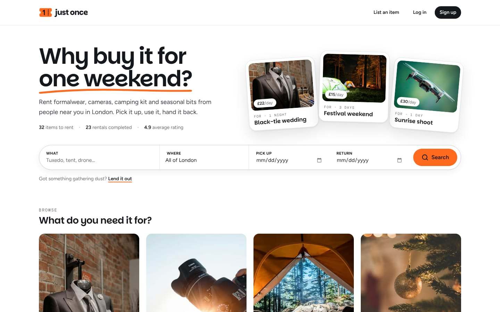
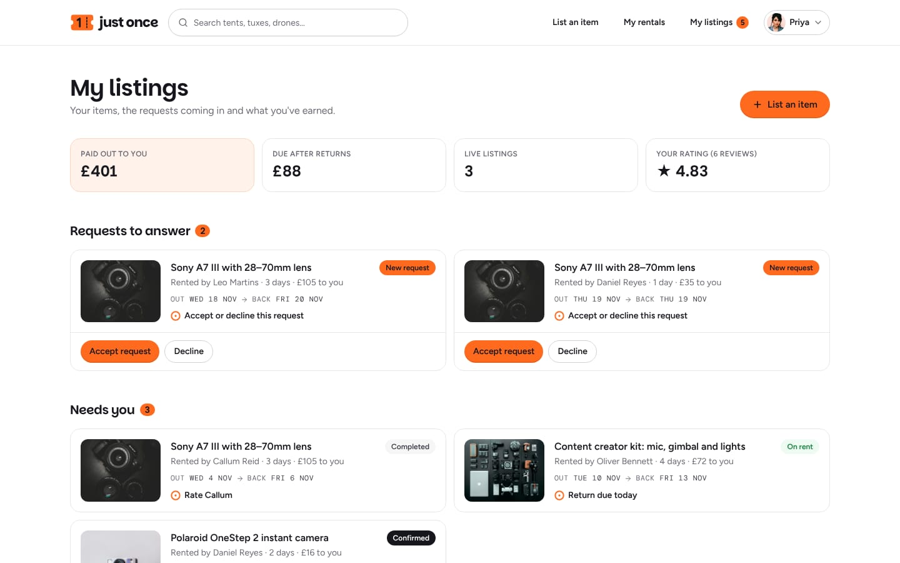
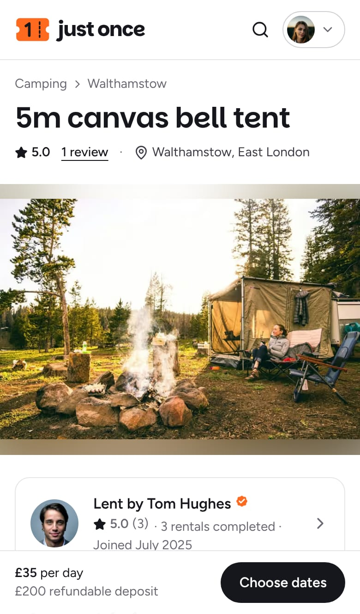
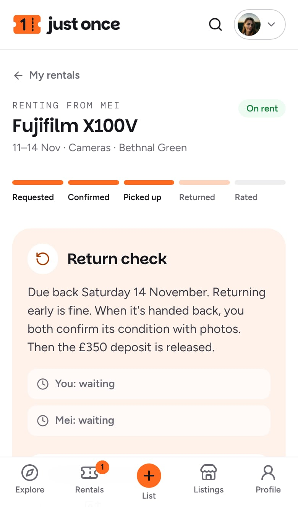
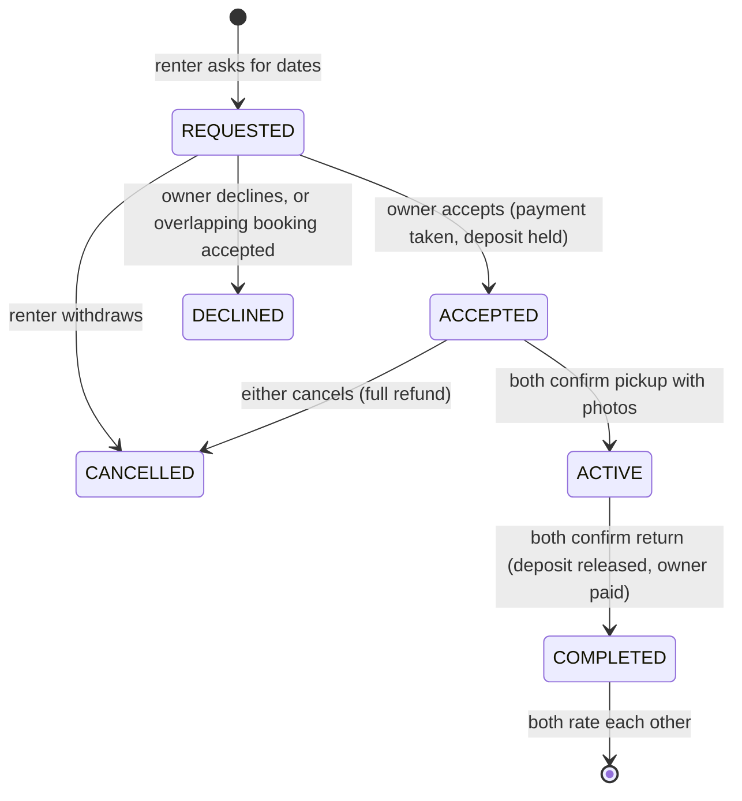

# Just Once

**Rent the things you only need once.** Just Once is a peer-to-peer rental marketplace for London: an outfit, a designer bag or a watch for a wedding, a camera for a weekend away, a tent for a festival, a Santa suit for the office party. Owners earn from things sitting in a cupboard; renters don't buy something they'll use once and then store in a small flat.

Built for AI Cup, Track B (Creativity & Commerce). The core journey works end to end: list → search → book → accept → pickup check → return check → deposit back → ratings.

| Home | Item page | Booking request (owner) |
| --- | --- | --- |
|  |  |  |

| Owner dashboard | On a phone: item | On a phone: return check |
| --- | --- | --- |
|  |  |  |

---

## Contents

- [Run it locally](#run-it-locally)
- [Put it on a public URL (Vercel + Neon)](#put-it-on-a-public-url-vercel--neon)
- [Demo accounts](#demo-accounts)
- [Suggested demo script](#suggested-demo-script)
- [Before you present](#before-you-present)
- [What's in the app](#whats-in-the-app)
- [How it works](#how-it-works)
- [Data model and the future swap option](#data-model-and-the-future-swap-option)
- [Testing](#testing)
- [Scripts and environment variables](#scripts-and-environment-variables)
- [Limitations and next steps](#limitations-and-next-steps)

---

## Run it locally

You need **Node.js 20.9 or newer** (22 LTS recommended) and a **PostgreSQL** database (14 or newer).

1. Install dependencies:

   ```bash
   npm install
   ```

2. Create your `.env` file (the defaults match the Docker database below):

   ```bash
   cp .env.example .env
   ```

3. Start Postgres. With Docker:

   ```bash
   docker compose up -d
   ```

   No Docker? Create a free database at [neon.tech](https://neon.tech) and paste its connection string into `DATABASE_URL` and `DATABASE_URL_UNPOOLED` in `.env`. Postgres.app or a local install works too.

4. Create the tables and load the demo data:

   ```bash
   npm run setup
   ```

5. Start the app and open <http://localhost:3000>:

   ```bash
   npm run dev
   ```

To try it on your phone over Wi-Fi, open the "Network" address that `npm run dev` prints (for example `http://192.168.1.20:3000`).

## Put it on a public URL (Vercel + Neon)

Both have free plans and need no credit card. Allow about 10 minutes.

1. Push this repository to GitHub (it already is if you're reading this there).
2. Go to [vercel.com/new](https://vercel.com/new), sign in with GitHub and **import** the repository. Leave the framework as Next.js and every build setting as it is: `vercel.json` already tells Vercel to run `npm run vercel-build`.
3. Before you deploy (or straight after the first deploy fails because it has no database), open the project's **Storage** tab, choose **Create Database → Neon**, and connect it to the project for all environments. This adds `DATABASE_URL` and `DATABASE_URL_UNPOOLED` to the project's environment variables.
4. Optional but recommended: in **Settings → Environment Variables**, add `DEMO_RESET_KEY` with a long random value. It lets you reset the demo data from the browser (see [Before you present](#before-you-present)).
5. Deploy (or **Redeploy** from the Deployments tab). The build runs the database migrations and, on a brand-new database only, loads the demo data. Later deploys never wipe your data.

Your app is now live at `https://<project-name>.vercel.app`. Share that link with the judges.

**Other hosts.** Anything that runs Node.js with a Postgres database works (Railway, Render, Fly.io, a VPS). Set `DATABASE_URL` (and `DATABASE_URL_UNPOOLED` if your provider gives you a separate direct connection), then run `npm run db:migrate`, `npm run db:seed`, `npm run build` and `npm start`.

**If `npm run dev` shows "require() of ES Module … magic-string" on your computer:** delete the `.next` folder and run `npm install` again (`rm -rf .next && npm install`), or update Node.js to 22 LTS.

**If something goes wrong on Vercel:**

- *"DATABASE_URL is not set"* in the build log: the Neon database isn't connected to this project, or not for the Production environment. Connect it, then redeploy.
- *"prepared statement already exists"* at runtime: add `&pgbouncer=true` to the end of `DATABASE_URL` in the project settings and redeploy.

## Demo accounts

Every demo account uses the password **`justonce`**. In demo mode the log-in page also has one-tap buttons for the main accounts, and the account menu (top right) has a "Switch demo account" list, so you can jump between owner and renter in two clicks.

| Person | Email | Role | Waiting for them after a fresh seed |
| --- | --- | --- | --- |
| **Sophie Clarke** | `sophie@example.com` | Renter, Islington | A camera on rent to return (Fujifilm X100V, due tomorrow), an open deposit claim from Sam to accept or contest, a ski kit booked for next month, a gown request waiting on Amara, past rentals with reviews |
| **Priya Shah** | `priya@example.com` | Owner, Hackney | Two *overlapping* requests for her Sony A7 III, a Polaroid pickup due today, two returns to confirm for the AI photo comparison (the content-creator kit, where the renter's return photo is missing the microphone, and a Sony A7 III rental to Zara, where it shows a scratch across the lens ring), a review to write |
| Amara Okafor | `amara@example.com` | Owner, Peckham | Sophie's request for the plum evening gown; dresses, costumes and Halloween props |
| Leo Martins | `leo@example.com` | Renter and owner, Brixton | Waiting on Priya's answer about the Sony; a tuxedo booked for a black-tie party |
| Tom Hughes | `tom@example.com` | Owner, Walthamstow | Tents and camping kit; a bell-tent booking next week |
| Oliver Bennett | `oliver@example.com` | Owner, Shoreditch | Callum's request for his Rolex Explorer (full deposit only, £1,000); suits and monk straps |

Also seeded: `hannah@`, `callum@`, `daniel@`, `zara@`, `mei@`, `isla@` and `sam@example.com` (Sam isn't ID-verified, so you can show the unverified state and the "Verify your ID to halve deposits" prompt). Leo qualifies as a trusted renter, so he's quoted half deposits, and his tuxedo booking goes through a parcel locker; Sophie's ski kit comes by courier. Daniel's Fujifilm X-T3 rental shows a settled claim (£25 kept for a missing lens hood). In total: 13 people, 52 listings across 11 categories, 46 bookings in every state and 59 reviews. The categories come in two groups: **Fashion** (formalwear, clothing, shoes, bags, jewellery, watches, accessories and costumes) and **Kit and occasions** (cameras, camping and seasonal). All dates are relative to the day you seed, so the demo always looks current.

## Suggested demo script

About 6 minutes. Use **two screens** so the judges watch both sides of the same rental: the owner on the laptop and the renter on a phone (or a second browser window in private mode). Pages refresh themselves every few seconds, so when one side acts, the other screen catches up without anyone touching it.

**Setup:** reset the demo data, log the laptop in as **Priya** (owner) and the phone in as **Sophie** (renter). Have one or two photos of a camera on the laptop.

1. **The pitch (30 s), home page.** "Why buy it for one weekend?" Point out the three occasion tickets, the categories (Fashion, then Kit and occasions) and the search by item, area and dates.
2. **An owner lists an item (75 s), laptop as Priya.** Click **List an item**. Upload a photo of a camera and press **Fill in from photo**: within a few seconds the title, category, condition and description fill in, with a suggested price and deposit and the reason for each. Point out the *Suggested* marks, correct one field so its mark disappears, and choose pickup area **Hackney**. (No AI key set? Fill it in by hand: *Canon EOS R6 body*, **Cameras**, **Like new**, **£40 a day**, **£500 deposit**.) In the calendar, tap two days to block them out. Watch the live preview on the right, then **Publish listing**. It's live straight away and appears in *Just listed* on the home page.
3. **A renter books it (60 s), phone as Sophie.** Search *Canon*, or tap Cameras and filter to East London, and open the new item. Tap a pickup day and a return day: the "return ticket" fills in with the out and back dates, £40 × days, the 10% service fee and, on the tear-off stub, the refundable deposit. Add a note and **Request to book**. Sophie sees *Waiting for Priya to respond* and hasn't been charged.
4. **The owner accepts (30 s), laptop.** The *My listings* badge shows a new request. **Accept request**: the toast confirms Sophie has paid and the deposit is held (simulated). Those dates are now locked, and the phone flips to the pickup check on its own.
5. **Pickup check (60 s), both screens.** On each screen add a photo (on the phone, take one with the camera, or tap *Use the listing photo (demo)*), confirm the item matches the listing and press **Confirm pickup**. Once both have confirmed, the ticket's stamp changes to **ON RENT**.
6. **Return, deposit and ratings (60 s).** Both press **Confirm return** with a photo. The deposit stub turns green: *released to Sophie*, and Priya's payout is marked paid. Each rates the other with stars and a comment, and the reviews appear on both profiles.
7. **When something comes back damaged (optional, 60 s).** At the return check, the owner picks *Something's changed*, adds a note and confirms. The deposit stays on hold, and the owner claims part of it with a reason. The renter sees the pickup and return photos side by side and can accept (the rest comes back straight away) or contest. A contested claim shows a *Resolve claim (demo)* control so you can play the support team. To show it without acting it out, log in as Sophie and open her Christmas decorations rental: Sam's claim is waiting for her.
8. **Double booking can't happen (30 s), laptop.** Open Priya's Sony A7 III request from Leo. The page warns that one other request overlaps. Accept it: Daniel's overlapping request is declined automatically and he isn't charged, and the dates are crossed out on the calendar. Mention that this is also enforced by the database itself, not just the screen.

**AI photo comparison (optional, 30 s, needs an AI key).** As Priya, open the content-creator kit booking. Oliver has already confirmed the return, and his photo is the pickup flat lay with the Rode microphone gone. Within a few seconds a **Compared with pickup** panel appears above Priya's return form and under Oliver's photos, with a finding along the lines of *"Microphone not visible in the return photos"*. For a subtler case, open Priya's Sony A7 III rental to Zara: the return photo has a light scratch across the lens ring. It is small enough that the comparison can miss it, and that is worth saying out loud. Point out that it is a suggestion: Priya still chooses *Yes, same as before* or *Something's changed* herself, and the deposit only moves on her choice.

**Short on time?** Skip steps 2 to 4 and use the seeded bookings: as Sophie, return the Fujifilm X100V; as Priya, confirm the content-creator kit return (the renter has already confirmed, so Priya's confirmation completes it) and rate Callum.

**Talking points for Creativity & Commerce:** owners keep 100% of their daily price and renters pay a 10% service fee, so the platform earns on every rental while owners see the full price they set. Deposits plus photo checks at both handovers make renting from a stranger feel safe. The data model is ready for a swap option, and every rental is one fewer thing bought for a single use.

## Before you present

The demo data's dates are relative to the day it was seeded, so **reset it on the day** (this also deletes any test accounts and bookings made since):

- **From the browser:** open `/demo/reset` on your deployed site and enter your `DEMO_RESET_KEY`.
- **From a terminal:** `curl -X POST https://<your-app>.vercel.app/api/demo/reset -H "x-demo-key: <your key>"`
- **Locally:** `npm run db:seed` (point `DATABASE_URL` at the production database to reset production).

Resetting logs everyone out. If you're showing the site on a phone, log in again afterwards.

## What's in the app

| Page | What it does |
| --- | --- |
| Home `/` | Search (item, area, dates), categories grouped into Fashion and Kit and occasions with live counts, featured items, newest listings, how it works, an earnings pitch for owners |
| Search `/search` | Filters for category, dates (only shows items free on those dates), area (a neighbourhood or a whole region such as East London), price, delivery available and sort; List / Map toggle with price pins and "Search this area"; "Near me" sorts by distance (location stays in the browser) |
| Item `/items/[id]` | Large photo gallery, availability calendar (booked and blocked days crossed out), map of the pickup neighbourhood, handover choice (meet, courier or locker), price breakdown, deposit, owner profile and reviews |
| List an item `/listings/new`, edit `/listings/[id]/edit` | Photos (resized in the browser), **AI draft from a photo**, category, condition, price, deposit, pickup area and private pickup details, availability window plus days blocked out; pause, resume or remove a listing |
| My rentals `/dashboard/rentals` | Renter view: what needs you, what's on rent, upcoming, past |
| My listings `/dashboard/listings` | Owner view: requests to accept or decline in place, what needs you, earnings, your items, past bookings |
| Booking `/bookings/[id]` | The whole rental on one page: progress, the next step, the return ticket, pickup and return checks with photos, deposit claims (claim, accept, contest, review), ratings, activity timeline |
| Profile `/users/[id]` | Verified badge, rating, items, reviews from renters and from owners |
| Account `/account` | Edit profile and photo, simulated ID verification, log out |
| Policies `/policies` | Booking, payments and fees, deposits, half deposits for trusted renters, handover checks, damage claims, cancellations, reviews and privacy, in plain English |
| Log in, sign up | Email and password; one-tap demo accounts in demo mode |

**Deposits.** Refundable deposit: held when the owner accepts, returned in full when the item comes back complete and undamaged. If the owner reports a problem at the return check, the deposit stays held and they can claim up to the full amount (damaged, parts missing, not cleaned or returned late) within 48 hours. The renter accepts or contests; contested claims are reviewed (in demo mode, by whoever is presenting). If the owner never confirms the return, or doesn't claim within 48 hours, the deposit is released automatically. Trusted renters (ID-verified, 3+ completed rentals, 4.5+ average from owners, no claim against them still open) pay half the deposit, unless the owner ticks *Always take the full deposit*. Owners can enter a replacement value to get a suggested deposit (25%, at least £20).

Payments, deposits and payouts are **simulated**: the app shows every amount and status change (paid, deposit held, deposit released, refunded, paid out) without a payment provider. ID verification is simulated too.

**AI: photo-to-listing.** On *List an item*, once a photo is uploaded, **Fill in from photo** drafts the title, category, condition, brand, size and description, and suggests a daily price and deposit. The price and deposit come from the median of similar active listings in the database, with the reason shown; with fewer than three similar listings it says so and uses an estimate instead. Every AI-filled field is marked *Suggested, check before publishing* until the owner edits or confirms it, and anything the photo doesn't settle is left empty with a question rather than a guess. It needs an AI key (`GEMINI_API_KEY` or `ANTHROPIC_API_KEY`); without one the button is hidden and listing works as before.

**AI: describe what you need.** Under the home page search, a renter can type a sentence such as *"black-tie wedding on Saturday, under £50 a day"*. AI turns it into the ordinary search filters (category, area, dates, price) and the normal search page shows the results, so every item, price and free date comes from the database, never from the model. The filters appear as removable chips, so a wrong guess is one tap to fix. If the AI call fails, or there is no key, it falls back to a plain keyword search.

**AI: photo comparison at pickup and return.** Both sides already photograph the item at each handover. Once a return check is saved, AI compares those return photos with the pickup photos and lists what looks different: *"Possible new scratch on the lens ring (photo 2)"*, *"Lens cap not visible in the return photos"*, or *Looks the same as at pickup*. If the photos are too dark or taken from too different an angle it says so and suggests retaking them. At pickup it does a lighter check that the photos look like the listed item. Owner and renter see the same panel on the booking page, in the timeline, and next to a deposit claim if one is opened. It is advice only: it never changes the deposit or the booking, and the owner still ticks *same condition* or *something's changed* themselves. The comparison runs after the check is saved, so a slow or failed AI call, or no key at all, leaves the handover working exactly as before.

**AI: search with a photo.** Also under the home page search, a renter can upload or take a photo of the thing they need. AI names the kind of item ("two-person dome tent") and picks a category and keywords, and the normal search page shows similar items to rent. It matches the kind of item, not the exact model. The photo is shrunk in the browser, used for that one question and not stored.

## How it works

**Stack:** Next.js 16 (App Router, React Server Components, Server Actions), React 19, TypeScript, Tailwind CSS 4, PostgreSQL with Prisma 6, Zod for validation. Fonts are self-hosted: Parkinsans for headings, Figtree for text and DM Mono for ticket details.

**Design:** white space, large photos and one accent colour (tangerine `#FF6A1F`, always with dark text for contrast). The signature element is the **return ticket**: the booking summary is drawn as a ticket with an *out* and a *back* date, a perforated tear line and a stub for the deposit, the part that comes back to you. On the booking page the ticket is stamped with its status.

**The rental lifecycle:**



Key decisions:

- **No double bookings, three layers deep.** The calendar won't let you pick a booked day; the server re-checks the dates on every request; and accepting runs in a transaction that locks the listing row. Underneath, Postgres has an exclusion constraint (`btree_gist`) so two confirmed bookings for the same item can never share a day, whatever the app does. Pending requests don't block dates; when the owner accepts one, overlapping requests are declined automatically.
- **Auth** is email and password (bcrypt). Sessions live in the database; the cookie is `httpOnly` and the database stores only a SHA-256 hash of its token.
- **Photos** are resized to 1600 px JPEG in the browser before upload, which also strips EXIF data such as a phone's GPS location. They're stored in Postgres and served from `/api/images/[id]` with long-lived caching and Next.js image optimisation, so the app deploys without a separate file store. The server checks the file type from its first bytes and only accepts photo URLs from its own uploads.
- **Pickup details stay private:** renters see the area up front and the owner's exact pickup notes only once a booking is accepted.
- **Both sides always know what's next:** each booking computes its next step for the person looking at it ("Pickup check due today", "Rate Callum"), which drives the badges in the header and the *Needs you* sections.
- **Live updates without websockets:** booking pages and dashboards quietly re-fetch every 5–8 seconds while visible, pausing while someone is typing or has unsaved photos.
- **The demo looks current:** seed dates are offsets from today, so there's always a pickup due today and a return due tomorrow.

**Project layout:**

```
prisma/              schema, migrations (including the double-booking constraint), seed entry point
public/seed/         demo photos (see public/seed/CREDITS.md)
src/app/             pages and API routes (one folder per route)
src/components/      UI: calendar, booking ticket, photo uploader, forms, cards
src/lib/             pure logic shared by server and browser: dates, money, booking rules, areas
src/server/          database, auth, queries, server actions, seed data
e2e/                 Playwright end-to-end tests
```

## Data model and the future swap option

Listings store their handover methods and an optional exact pickup point (only ever sent to a renter with an accepted booking); bookings store the chosen method, delivery fee, address or locker. Main tables: `User`, `Session`, `Listing`, `BlockedDate`, `Booking`, `HandoverCheck` (one per side per stage, with photos), `DepositClaim`, `Review`, `BookingEvent` (the timeline) and `ImageBlob` (uploaded photos). Money is stored in pence; rental dates are Postgres `date` values.

Swaps aren't built, but the model is ready for them:

- `ExchangeType` is an enum with `RENTAL` and `SWAP`.
- `Listing.exchangeTypes` says how an item can change hands (today always `[RENTAL]`).
- `Booking.type` defaults to `RENTAL`, and `Booking.offeredListingId` is reserved for the requester's own item offered in exchange.

Adding swaps means: letting owners tick "open to swaps", offering one of your listings instead of paying, skipping payment and payout for `SWAP` bookings, and running the same pickup and return checks for both items. The statuses, checks, reviews and timeline all carry over unchanged.

## Testing

```bash
npm run typecheck
```

```bash
npm test
```

```bash
npm run test:e2e
```

- `npm test` runs unit tests for the pricing, deposit, date and booking rules (`src/lib/__tests__`).
- `npm run test:e2e` drives the real app with Playwright through the whole journey in two browsers: an owner signs up and lists an item with a photo upload, a renter searches and books, the owner accepts, both confirm pickup and return, the deposit is released, both leave reviews, and overlapping requests are declined automatically. `e2e/map.spec.ts` checks pins match the results, "Near me" with location allowed and refused, and that pickup details stay private until acceptance. `e2e/delivery.spec.ts` books with a courier and checks the server rejects a method the listing doesn't offer. `e2e/deposits.spec.ts` covers damage claims (claim → accept, claim → contest → resolve) and half deposits for trusted renters. A last test checks the phone layout. It starts `npm run dev` if nothing is running; to test another server, set `E2E_BASE_URL`. First-time setup: `npx playwright install chromium`. **The tests create data, so run `npm run db:seed` afterwards.**

## Scripts and environment variables

| Script | What it does |
| --- | --- |
| `npm run dev` | Start the development server |
| `npm run setup` | Apply migrations and load the demo data |
| `npm run db:migrate` | Apply database migrations |
| `npm run db:seed` | Wipe the database and reload the demo data (dates relative to today) |
| `npm run build` / `npm start` | Production build and server |
| `npm run vercel-build` | What Vercel runs: migrate, seed only if the database is empty, build |
| `npm test`, `npm run test:e2e`, `npm run typecheck` | Unit tests, end-to-end tests, type checks |

| Variable | Required | Purpose |
| --- | --- | --- |
| `DATABASE_URL` | Yes | Postgres connection string (the pooled one on Neon) |
| `DATABASE_URL_UNPOOLED` | Optional | Direct connection for migrations; falls back to `DATABASE_URL` |
| `DEMO_RESET_KEY` | Optional | Turns on `/demo/reset` and `POST /api/demo/reset` |
| `GEMINI_API_KEY` | Optional | Turns on the AI features (photo-to-listing, describe-what-you-need search, photo search and the pickup/return photo comparison) using Google Gemini, which has a free tier. Server-side only |
| `ANTHROPIC_API_KEY` | Optional | Same features using Anthropic's Claude (paid per call). Set one of the two keys; with neither, the AI features are hidden |
| `AI_PROVIDER` | Optional | `anthropic` or `gemini`. Only matters when both keys are set; Anthropic is the default |
| `AI_MODEL` | Optional | Model override. Defaults to `gemini-3.5-flash-lite` or `claude-haiku-5-5` depending on the provider; ignored if it names the other provider's model |
| `NEXT_PUBLIC_DEMO_MODE` | Optional | Set to `false` to hide the one-tap demo log-ins and account switcher (takes effect on the next build) |

## Limitations and next steps

This is a competition demo, so some things are deliberately simulated or left out:

- **Payments:** simulated. In production this would be Stripe Connect, with the deposit held as an uncaptured authorisation and released after the return check.
- **ID verification:** simulated. A real version would hand off to a provider such as Stripe Identity.
- **AI drafts are suggestions:** photo-to-listing can misread an item, so nothing is published until the owner has checked it. The photos used for a draft are sent to the AI provider (Google or Anthropic, whichever key is set). On Gemini's free tier, Google may use what is sent to improve its products, so use a paid key for anything beyond a demo. Drafts aren't logged yet, and there is no saved fallback response for a demo with bad wifi.
- **Photo comparison is advisory and can miss things:** the "Compared with pickup" panel is an AI suggestion, not a verdict. Different lighting, angles and framing mean it can miss real damage, flag something that isn't there, or call a part missing when it is only out of frame. It only sees up to three photos from each handover, and nothing it can't see (how the item works, smells, the inside of a bag). It never moves a deposit: the owner's own check and, for contested claims, a human review decide that. It runs after the check is saved rather than while the photos are being added, so an owner who confirms first only sees the comparison of their own photos afterwards. Both people's handover photos are sent to the AI provider, with the same caveat about Gemini's free tier as above.
- **Photo search** matches on category and keywords, not on how the item looks, so results are "the same kind of thing" and not visual lookalikes. The photo is sent to the AI provider.
- **Describe-what-you-need search** picks filters only: it doesn't filter by size, suggest bundles or post "wanted" requests yet, and budgets map to the nearest price filter at or below what was asked.
- **Delivery:** couriers and lockers are simulated, with demo prices and timeline steps. A real version would call a courier API and a locker network.
- **Maps:** OpenStreetMap tiles are fine for a demo; switch to a tile provider with a usage plan for real traffic.
- **Not built yet:** in-app messages, a real support team for contested deposit claims, email and push notifications, and the swap option described above.
- **Demo mode** publishes the demo password and adds one-tap log-ins. Set `NEXT_PUBLIC_DEMO_MODE=false` for anything beyond a demo.

Photos come from [Unsplash](https://unsplash.com) under the Unsplash License (details in [`public/seed/CREDITS.md`](public/seed/CREDITS.md)). The people, listings and reviews are made up.
